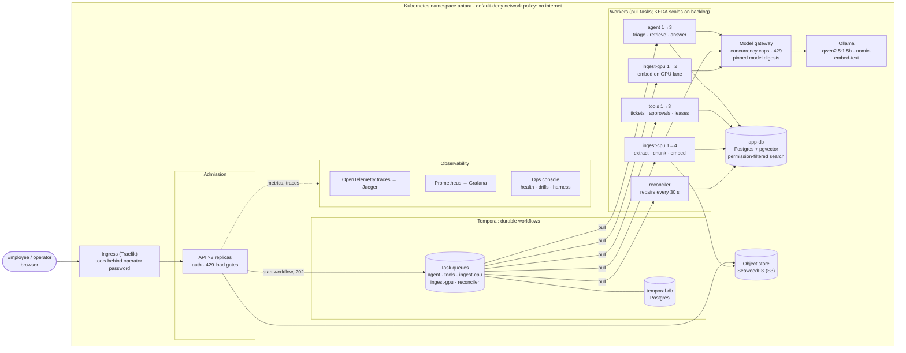

# Architecture

Antara is a private IT and security helpdesk. Employees ask questions and request access; answers come only from company documents the asker may read, and nothing leaves the company network. The whole system runs on one Kubernetes (k3s) node on a laptop, and the same manifests run on AWS.

## The picture

## How a question flows

1. The browser sends the question to the **API**. The API checks who is asking and whether the system has room (otherwise **429** with `Retry-After`), starts an **AgentRunWorkflow** in Temporal and returns **202** with a run id at once.
2. An **agent worker** pulls the next task from the `agent` queue. Whichever worker is free takes it; that is the load balancing.
3. The worker classifies the request (question, action or incident), checks the answer cache, and searches **pgvector with the asker's groups inside the query**, so documents they may not read are never candidates.
4. If no passage scores 0.6 or more, it answers that it could not find it, without calling the model. Otherwise it calls the **model gateway**, which caps concurrent model calls (busy → 429, retried with backoff), refuses calls if a model's digest does not match, and forwards to **Ollama** inside the cluster.
5. The harness strips injected instructions from passages, redacts secrets and blocks unsafe answers. The browser polls the run and shows the answer with its sources and a five-check harness receipt.
6. Every hop is traced with OpenTelemetry, so one Jaeger trace follows the question from the API through Temporal, the worker and the gateway to the model.

## How an action flows (access request)

1. The model proposes `request_access`; the harness checks the asker's group and fills missing details from their words.
2. The workflow opens an approval and **waits durably**: the wait survives worker restarts and a full node restart. A manager approves (after 2 minutes it escalates to security leads; after 24 hours it expires).
3. The tool runs **once per idempotency key**. The grant starts an **AccessLeaseWorkflow** whose durable timer revokes the access when the lease ends: 30 days for read and 7 for write in production, 3 and 2 minutes on the demo cluster.

## How a document flows

Upload → API checks size (5 MB) and that the uploader shares only with their own groups → object store → **IngestWorkflow**: extract text → chunk → embed (GPU lane first; if no GPU worker picks it up within 20 s, CPU) → publish. Embedding retries patiently for up to 30 minutes and heartbeats, so a killed worker is noticed within 30 s. The **reconciler** re-runs stuck documents and rebuilds missing vectors every 30 seconds. Deleting a document purges its file, chunks, vectors and cached answers.

## Where each part lives

| Folder | Holds |
| --- | --- |
| `api/` | HTTP API, auth, admission gates, operations console backend, web pages |
| `agent/` | Agent and lease workflows, triage, tools, harness guards |
| `ingest/` | Ingest and delete workflows, GPU/CPU dispatch, permission-filtered search |
| `reconciler/` | Scheduled repair of stuck and corrupted documents |
| `gateway/` | Model gateway: concurrency caps, chaos switch, model verification |
| `common/` | Shared contracts, config, model client, storage, telemetry |
| `deploy/` | k3s manifests, KEDA, network policy, observability, AWS scripts |

Every slice keeps business rules in `services.py` behind `ports.py`, with all I/O in adapters; `tests/test_architecture.py` fails if a rule imports a tool. See [AGENTS.md](../AGENTS.md).
